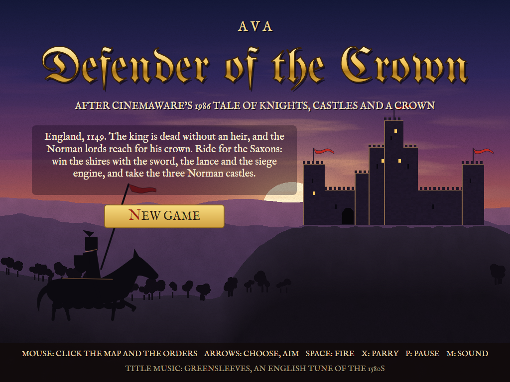
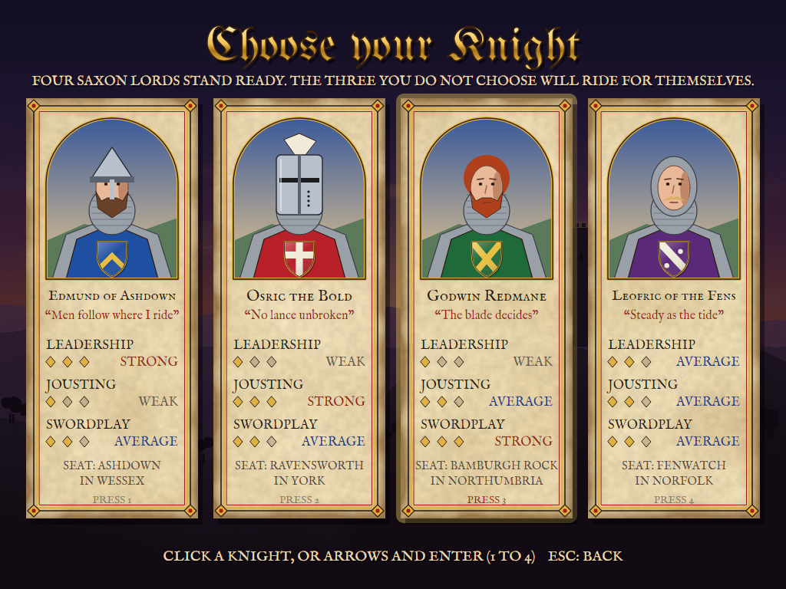
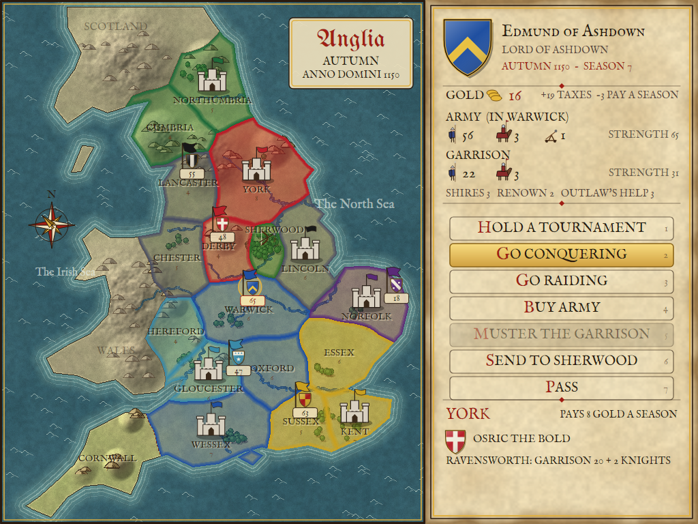
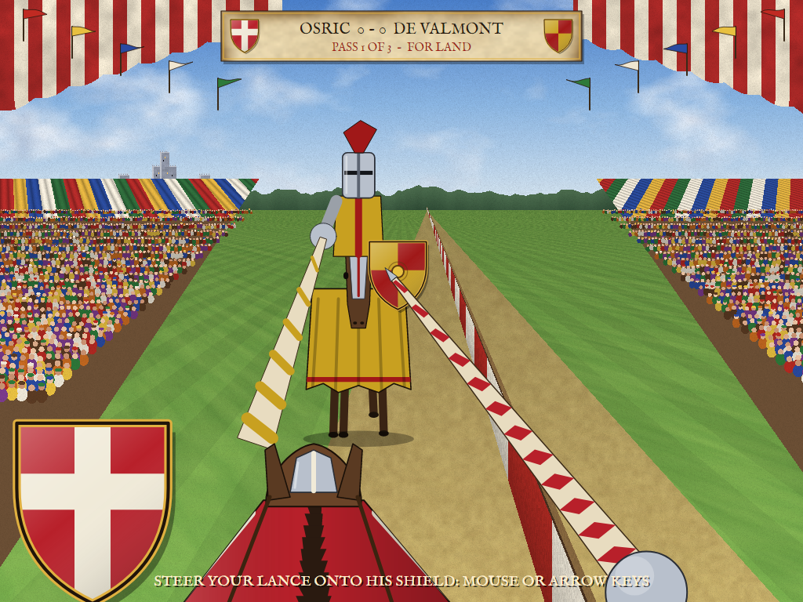
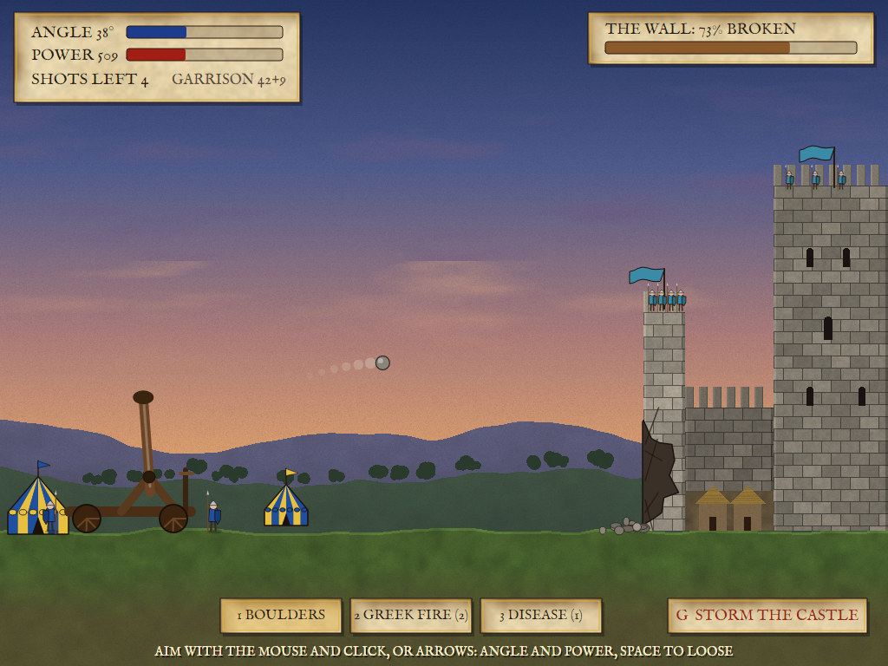
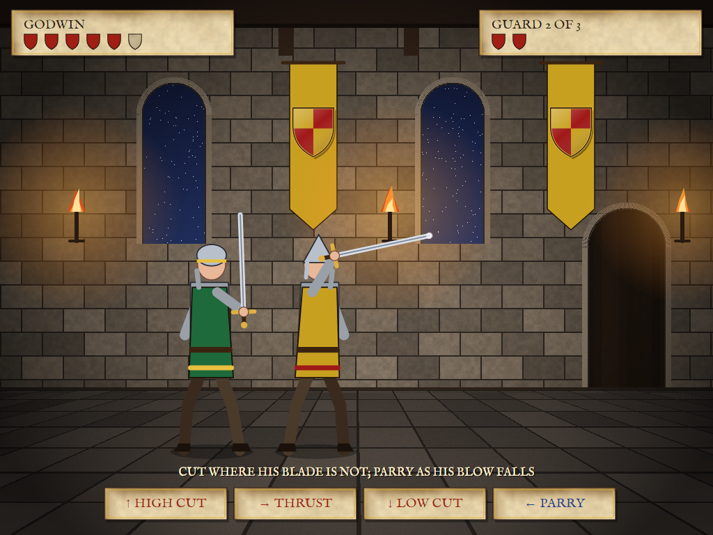
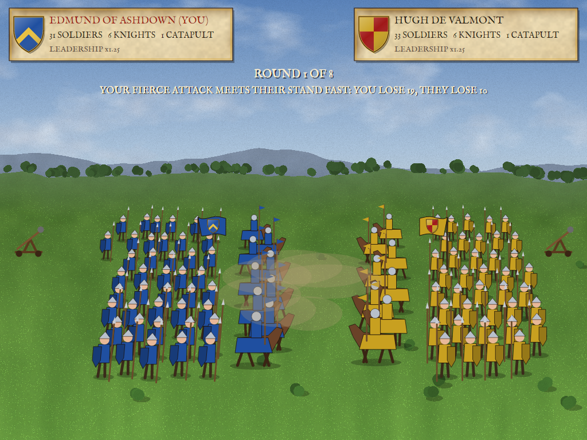
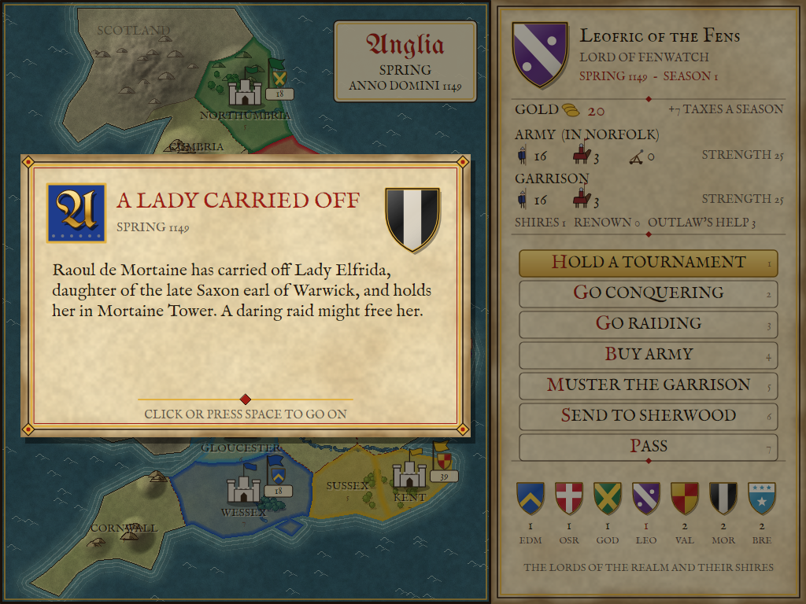
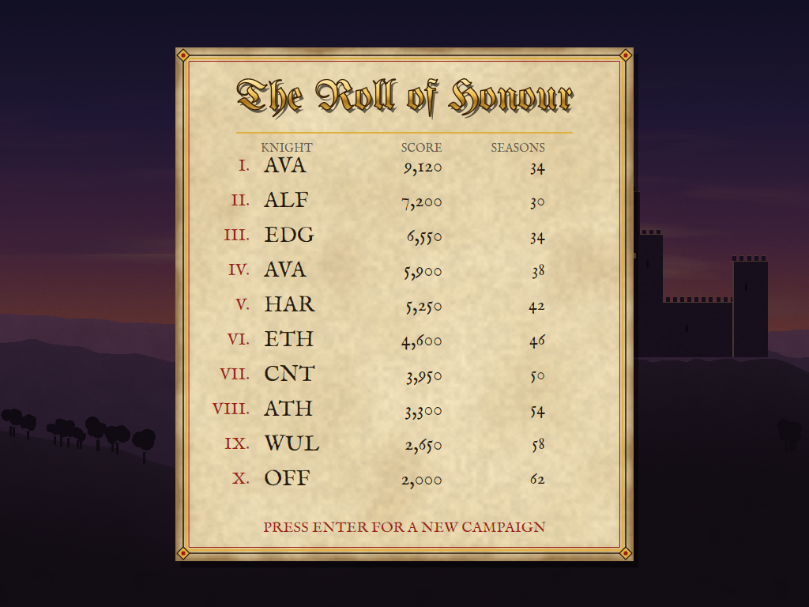

# AVA Defender of the Crown

[](https://github.com/Harlock123/AVADefenderOfTheCrown/actions/workflows/build.yml)

A game of knights, castles and a crown in the style of Cinemaware's 1986 **Defender of the Crown**, built with
.NET 10 and Avalonia UI. England, 1149: the king is dead without an heir, and three Norman lords mean to have his
crown. Ride out as one of four Saxon knights, win the shires one by one with your army, joust for land and fame,
raid castles by night with your sword in your hand, batter Norman walls with your catapult, free a Saxon lady from
a Norman tower, call on the outlaw of Sherwood when you need him, and take all three Norman castles to be crowned.

## Features

- **Four Saxon knights**, each better at something: **Edmund of Ashdown** (a strong leader, a weak jouster),
  **Osric the Bold** (the finest lance in England), **Godwin Redmane** (deadly with a sword) and **Leofric of the
  Fens** (steady at everything). Leadership makes your armies fight harder, jousting steadies your lance, and
  swordplay gives you more time to parry and more strength in a raid. The three you don't choose ride for
  themselves.
- **The map of England**, painted like an old manuscript map: eighteen shires from Northumbria to Cornwall, each
  paying its lord gold every season, the hills shaded, the woods and rivers drawn in, Wales and Scotland greyed off,
  each lord's shires washed in his colours, his castle flying his banner and his army marching under it. Click a
  shire to see whose it is, what it pays and who holds it.
- **Seven lords**, each with his own castle and his own arms: you, the three other Saxons, and the Norman lords
  **Hugh de Valmont** in Kent, **Raoul de Mortaine** in Lincoln and **Guy de Brecy** in Gloucester, who begin with
  more land, bigger armies and catapults. Sherwood belongs to the outlaws, and the rest of the shires to nobody yet.
- **Your orders each season:**
  - **Hold a tournament**, for land (unseat a lord and his best shire is yours, or lose one of your own) or for fame
    (a purse of gold, renown, and knights who ride to a champion's banner).
  - **Go conquering:** march your army into a shire next to it. Your own shires and empty ones are a walk; anywhere
    else there's a battle with the shire's vassals or the army that holds it; a castle must be besieged first.
  - **Go raiding:** a swordfight through a castle by night, for half its lord's gold, or to free the lady.
  - **Buy army:** soldiers (1 gold), knights (4 gold, worth three soldiers) and catapults (12 gold), for the army
    or the garrison. **Muster the garrison:** move men between the army and the castle's walls. Both are free.
  - **Send to Sherwood:** three times in the game, **Gil of the Greenwood** will rob a lord's tax wagons for you or
    send his archers to march with your army in its next battle.
  - **Pass.**
- **The joust**, seen down the lists from the saddle: the other knight gallops in from the far end of the field, his
  shield swaying with his horse's stride, while your lance point bobs with yours. Hold it on his shield as the
  horses meet: square on the boss and he's unhorsed; on the shield your lance shatters for a point; off it, nothing.
  He aims at you too. Three passes; the first knight down loses, otherwise the points decide.
- **The siege**, side-on: aim the catapult's angle and power with the mouse or the keys and hurl boulders at the
  castle's wall: low and hard breaks it best, the battlements sweep defenders off, and over the wall a boulder lands
  among the garrison. Two loads of Greek fire and one of disease do little to the stones but much to the men. When
  the wall is breached (or the shots are spent), the army storms the castle; the less wall is left, the less it
  shelters them.
- **The swordfight**, side-on in a torchlit hall: guard after guard steps up. Cut high, thrust, or cut low where his
  blade isn't; a stroke into his guard is turned aside. When he winds up a blow, parry it as it falls and he's left
  reeling, open to anything; strike him as he winds up and you'll trade wounds. Beat every guard for the
  strongroom, or for the lady; fall, and you're ransomed for half your gold.
- **The battle**, an animated clash on an open field, round by round: choose **stand fast**, **bombard** (with
  catapults), **fierce attack** or **retreat**, and the enemy chooses too. Each beats one other: a fierce attack
  overruns catapults at their work, a bombardment wears down a line standing fast, and a line standing fast breaks
  a fierce attack. Strength, leadership and castle walls do the rest.
- **The other lords take their turns:** they keep their garrisons up, buy armies, march on the shires next to their
  armies that they can take, hurry home when an enemy brings a catapult to their gates, and take one another's
  castles. Normans never fight Normans, nor Saxons Saxons, and only you can take a Norman castle. A Norman army
  marching on your castle (or on your army) is fought out on the field, by you.
- **The story** is told on illuminated cards, each with the arms of the lord it's about: the king's death, the
  Normans' advance, castles falling, the lady carried off and your wedding, the outlaws' help, and the end.
- **The end:** take all three Norman castles and you are crowned; lose your own and the Saxon cause is lost with you.
  The score counts your shires, your gold, your renown, the Normans you beat, your wedding, and for a crown, how soon.
  The best ten are written in the roll of honour with their initials.
- **The campaign is saved** at the start of every season; **CONTINUE** on the title picks it up again.
- **The demonstration:** left on the title, the computer plays a campaign of its own, scenes and all. It keeps its
  castle garrisoned against the Norman armies near it, takes the richest shire it can beat, buys a catapult for the
  castles, calls on the outlaws' archers before a storming, frees the lady, and jousts or raids when there's nothing
  to attack. It is crowned in most of its campaigns, in fourteen seasons or fifty, and stalls in a few.

## Screenshots

| The title | Choose your knight | The map of England |
|:---------:|:------------------:|:------------------:|
|  |  |  |
| A castle against the setting sun. | Four Saxons, four strengths. | Seven lords' shires, castles and armies. |

| The joust | The siege | A raid |
|:---------:|:---------:|:------:|
|  |  |  |
| De Valmont rides at you down the lists. | The wall gives way under the boulders. | A guard winds up a blow: parry it! |

| A battle | An event card | The roll of honour |
|:--------:|:-------------:|:------------------:|
|  |  |  |
| Your fierce attack against de Valmont's line. | A lady carried off. | The high scores. |

The screenshots are made by the tests, which play the game in a real (headless) window; see
[Tests](#tests).

## Download and run

Ready-to-run builds for Windows, macOS and Linux, on both Intel/AMD and ARM, are on the
[Releases page](https://github.com/Harlock123/AVADefenderOfTheCrown/releases/tag/latest). **Latest build** is
rebuilt on every push to `main`. Each download is one self-contained executable: no .NET install is
needed.

| Platform | Archive |
|---|---|
| Windows | `AVADefenderOfTheCrown-win-x64.zip`, `AVADefenderOfTheCrown-win-x86.zip`, `AVADefenderOfTheCrown-win-arm64.zip` |
| macOS | `AVADefenderOfTheCrown-osx-arm64.tar.gz` (Apple silicon), `AVADefenderOfTheCrown-osx-x64.tar.gz` (Intel) |
| Linux | `AVADefenderOfTheCrown-linux-x64.tar.gz`, `AVADefenderOfTheCrown-linux-arm64.tar.gz`, `AVADefenderOfTheCrown-linux-arm.tar.gz` |

```bash
tar -xzf AVADefenderOfTheCrown-linux-x64.tar.gz     # or linux-arm64, linux-arm, osx-arm64, osx-x64
./AVADefenderOfTheCrown
```

On Windows, unzip and run `AVADefenderOfTheCrown.exe`. On macOS, if Gatekeeper refuses to open it, run
`xattr -d com.apple.quarantine AVADefenderOfTheCrown` once. Run with `--no-audio` for silence.

**Sound** comes through OpenAL Soft, built in for every platform. In a virtual machine the game
detects it and uses a larger audio buffer, so the sound doesn't break up.

## Controls

The game is played with the mouse, like the original, but everything can be done from the keyboard or a gamepad.

| Action | Mouse | Keyboard | Gamepad |
|---|---|---|---|
| A new campaign / continue | NEW GAME, CONTINUE | Enter / C on the title | Start |
| Choose your knight | Click his portrait | Arrows and Enter, or 1 to 4 | D-pad and A |
| An order | Click it on the parchment | Up/down and Space or Enter, or 1 to 7 | D-pad and A |
| Pick a shire or a castle | Click it on the map (the choices glow) | Arrows to step through them, Enter | D-pad and A |
| Back out of an order | Right-click, or BACK | Backspace | B |
| Buy and muster | The - and + buttons | Up/down for the row, left/right for the number, Enter | D-pad and A |
| Joust: steer the lance | Move the mouse | Arrows or WASD | Stick or D-pad |
| Siege: aim and loose | Point at where to throw, click | Up/down angle, left/right power, Space | Stick, A |
| Siege: missile, storm | The buttons under the field | 1 boulders, 2 Greek fire, 3 disease, X next; G storms | X next, Y storms |
| Swordfight | The buttons, or click high, middle or low on the guard; right-click parries | Up high cut, right (or Space) thrust, down low cut, left (or X or Shift) parry | D-pad; A thrust, X parry |
| Battle tactic | Click it | 1 to 4, or arrows and Enter | D-pad and A |
| Read on past a card | Click | Space or Enter | A |
| Pause | | P or Esc | Start |
| Sound on/off | | M | |
| Screenshot | | Ctrl+S (to your Pictures folder) | |

## Tests

```bash
dotnet test AVADefenderOfTheCrown.slnx
```

The game runs in fixed 60 Hz steps, so it plays the same at any frame rate. Everything about a campaign lives in
one world that can be copied, saved and loaded, and every scene (the joust, the siege, the raid, the battle) is an
object of its own that can be stepped on its own. The tests check:

- **The realm:** eighteen shires whose borders run both ways and join them all up; seven lords, four Saxon and
  three Norman, each with his own castle and arms; who holds what at the king's death, and what it pays.
- **Money and men:** the season's taxes and the turning years; an army's pay and unpaid men deserting; buying
  soldiers, knights and catapults for the army or the garrison, and not beyond your gold; men moved between army
  and garrison only with the army at home.
- **Marching and conquering:** a walk, a battle or a siege by who holds the shire, and no catapult no siege;
  the vassals and the half-levies who defend; a shire won and the army moving in; a castle fallen, its lord
  finished and his lands and gold taken; your own castle lost; all three Norman castles taken and the crown; the score.
- **Battles:** each tactic beating one other; a bigger army winning; castle walls turning a winning army into a
  beaten one; leadership deciding an even fight; retreat and its parting blow; the attackers giving up after eight
  rounds; catapults needed to bombard; the outlaws' archers; the winners moving in and the losers going home.
- **The joust:** the geometry of a strike (on the boss, on the shield, off it, at the edges); a lance held on the
  shield as the horses meet landing where it was aimed, allowing for the bob; the bob smaller for a better jouster;
  the keys and the mouse steering the lance; unhorsing and being unhorsed; three passes to the points; both knights
  down riding the pass again; better jousters striking true more often.
- **The siege:** a shot's arc under gravity; where a shot comes down (short, the wall, the battlements, inside,
  over), predicted and flown alike; low hard boulders breaking the wall best and a breach ending the siege; Greek
  fire and disease killing more of the garrison; the shots and missiles counted; up raising the aim, right adding
  power, the mouse aiming along the line to it.
- **The swordfight:** a stroke where his blade isn't wounding him and one into his guard turned; a parry as the
  blow falls leaving him reeling and open; a parry too soon over before the blow; a better swordsman's longer parry
  and greater strength; a stroke as he winds up trading wounds; every guard beaten, or the hero taken.
- **Tournaments, raids, the outlaw and the lady:** land won and lost, a purse and knights for fame, a draw; half a
  lord's gold taken or half yours paid in ransom; the lady carried off, freed by a raid or by taking the castle,
  and the wedding with her father's shire and a dowry; the outlaws' raid and their archers, three times in all, the
  archers marching into the next battle only.
- **The other lords:** Normans never marching on Normans nor Saxons on Saxons; a lord marching on a weak
  neighbour and keeping his garrison up; no castle stormed in the first seasons and then a Norman army at your gate
  that you must fight, held or lost; their seasons' news.
- **The game:** the title, the choice of knight and the opening card; the orders, conquering, buying, a tournament
  and a raid from the keys; a siege before a storming; saving every season and continuing just as it was; the crown
  won and the initials entered in the roll of honour; the demonstration, the roll of honour and back to the title;
  the pause; the computer player's plans, and a whole campaign it plays to the crown, scenes and all; the mouse
  choosing a knight, giving orders, picking shires, buying, fighting with the sword and the catapult; the keys
  through the input handler (up is -1, as on the screen; the newest key wins; a Shift let go as CapsLock is let go;
  the mouse pointing until a direction key is pressed); a sound file for every sound.

`tests/AVADefenderOfTheCrown.Tests/PilotProbe.cs` reports how the computer player gets on over whole campaigns, for
tuning (`CROWN_PROBE=1`, `CROWN_GAMES=24`, `CROWN_SEASONS=80`): it was crowned in 18 of 24, in 14 to 55 seasons,
lost none, and stalled with a shire or two in the rest; two dozen campaigns take a fraction of a second.

The screenshot tests draw the real screen in a headless window. To refresh the README's pictures:

```bash
CROWN_SHOTS=$PWD/Images dotnet test tests/AVADefenderOfTheCrown.Tests --filter ScreenshotTests
```

## Building

```bash
dotnet build AVADefenderOfTheCrown.slnx
dotnet run --project src/AVADefenderOfTheCrown
```

Needs the .NET 10 SDK. The sounds and the music are made by `tools/make_sounds.py` (standard-library Python):
`python3 tools/make_sounds.py` rewrites `src/AVADefenderOfTheCrown/Sounds`.

## Project structure

```
AVADefenderOfTheCrown/
├── AVADefenderOfTheCrown.slnx
├── src/AVADefenderOfTheCrown/
│   ├── Engine/
│   │   ├── GameEngine.cs        # States, the map's orders and panels, the scenes, the cards, saving, the end, the table
│   │   ├── Realm.cs             # The shires, their borders and incomes, the lords and their arms, the coast of Britain
│   │   ├── World.cs             # Everything that changes in a campaign, kept so it can be copied
│   │   ├── Sim.cs               # The rules: money and men, marching and conquering, castles falling, tournaments,
│   │   │                        # raids, the outlaw, the lady, the other lords' turns, the seasons, the end, the score
│   │   ├── Battle.cs            # Army against army, round by round
│   │   ├── Joust.cs             # Down the lists from the saddle
│   │   ├── Siege.cs             # The catapult, its arc and the wall
│   │   ├── Raid.cs              # The swordfight by night
│   │   ├── Pilot.cs             # The computer player
│   │   ├── SaveFile.cs          # The campaign saved each season
│   │   ├── HighScoreTable.cs, InitialsEntry.cs
│   │   ├── InputHandler.cs, ControllerManager.cs   # Keys, mouse and gamepad (SDL2)
│   │   └── SoundManager.cs      # Effects and music through OpenAL
│   ├── Audio/                   # The OpenAL engine (from the author's AVABand)
│   ├── Views/
│   │   ├── MapArt.cs            # The painted map of England, which pixel is which shire, the owners' wash
│   │   ├── Art.cs, Pix.cs       # The painted backgrounds: parchment, the title, the lists, the siege, the hall, the field
│   │   └── GameCanvas*.cs       # The screen: the map and the parchment, heraldry and figures, the scenes, the cards
│   ├── Assets/Fonts/            # IM FELL English and UnifrakturMaguntia (SIL Open Font License)
│   └── Sounds/                  # The synthesised effects and music
├── tests/AVADefenderOfTheCrown.Tests/      # Gameplay, mouse and screenshot tests, and the computer player's probe
├── tools/make_sounds.py
└── Images/                      # Screenshots
```

## About and licence

AVA Defender of the Crown © 2026 Lonnie Watson, under the [MIT License](LICENSE).

*Defender of the Crown* © 1986 Cinemaware. AVA Defender of the Crown is an independent, unofficial game in its
style. Its graphics, sounds and code are its own: everything is drawn and synthesised by the program, and nothing is
taken from the original game's program, graphics or music. Its knights, lords, outlaw and lady are its own
inventions. It is not affiliated with or endorsed by Cinemaware or any other rights holder.

The title music is **Greensleeves**, an English tune registered in 1580, which is in the public domain. The fonts
are IM FELL English by Igino Marini and UnifrakturMaguntia by j. 'mach' wust and Peter Wiegel, both under the SIL
Open Font License (see `src/AVADefenderOfTheCrown/Assets/Fonts`).
